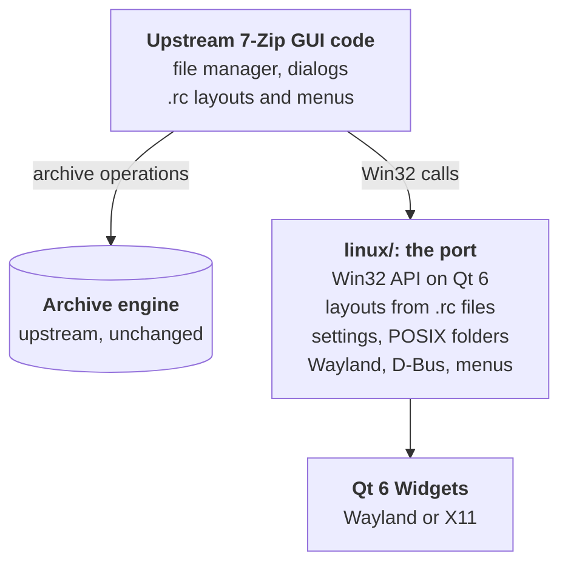

<div align="center">


# 7-Zip for Linux

**The original 7-Zip File Manager and dialogs, as a native Linux and Wayland app, in a dark theme.**

[](https://www.7-zip.org/)
[](https://github.com/mikigal/7zip-linux/releases)
[](https://www.qt.io/)
[](https://wayland.freedesktop.org/)
[](/DOC/License.txt)

[Install](#install) · [Security](#security) · [Build](#build-from-source) · [How the port works](#how-the-port-works) · [FAQ](#faq)

</div>

<p align="center">
  
</p>

7-Zip for Linux brings the Windows GUI of [7-Zip](https://www.7-zip.org/), the
**7-Zip File Manager** (`7zFM`) and the **7-Zip dialogs** (`7zG`), to Linux. It
is not Wine and not a look-alike: the windows run the upstream 7-Zip sources,
compiled against a small Win32-on-Qt layer, and the archive engine is
upstream 7-Zip **without a single changed line**.

> [!NOTE]
> This is an unofficial port. It is not affiliated with or endorsed by Igor
> Pavlov or the 7-Zip project. Upstream 7-Zip already has a console `7zz` for
> Linux; this project adds the graphical part on top of the same sources.

## Highlights

- **The real 7-Zip.** Dual-panel file manager (F9), archives opened as
  folders (archives inside archives too), Add, Extract and Test, CRC and SHA
  hashes, split and combine, links, bookmarks, folder history, the benchmark
  and every options page, with the keyboard shortcuts you know.
- **The original layout.** Every dialog is laid out from the upstream `.rc`
  templates. A test checks all 33 templates against the official Windows
  executables of 7-Zip 26.05, control by control.
- **Dark theme.** Qt's Fusion style with a dark palette, and the toolbar
  icons redrawn as SVG with more contrast.
- **Native Wayland.** Drag and drop to and from Dolphin, Thunar and web
  browsers, a clipboard that file managers understand, progress on the
  taskbar, and "Open with" through the desktop portal. It runs under X11 too.
- **File manager menus.** The 7-Zip context menu of Windows Explorer, built by
  the same upstream code, in Dolphin and other KDE apps, Nemo, Thunar and
  Nautilus.
- **Every format of 7-Zip 26.05.** Pack and unpack 7z, XZ, BZIP2, GZIP, TAR,
  ZIP and WIM. Unpack RAR, ISO, DMG, CAB, MSI, DEB and RPM, SquashFS, ZSTD,
  VHD(X), VMDK, QCOW2, NTFS, APFS, HFS and dozens more.
- **93 languages.** The translations of the official release; 7-Zip follows
  your locale or the language you pick in Tools > Options.

## Screenshots

<table>
  <tr>
    <td colspan="2"></td>
  </tr>
  <tr>
    <td colspan="2" align="center"><b>7-Zip File Manager</b>: an archive opened like a folder, with every column the format stores</td>
  </tr>
  <tr>
    <td width="50%"></td>
    <td width="50%"></td>
  </tr>
  <tr>
    <td align="center"><b>Add to Archive</b>: every option of 7-Zip</td>
    <td align="center"><b>Progress</b>: speed, ratio, Background and Pause</td>
  </tr>
  <tr>
    <td></td>
    <td></td>
  </tr>
  <tr>
    <td align="center"><b>Extract</b></td>
    <td align="center"><b>Benchmark</b></td>
  </tr>
</table>

## Install

Packages are attached to every [GitHub release](https://github.com/mikigal/7zip-linux/releases).
They are built by GitHub Actions from the tagged source and tested in a clean
container of each distribution. Download the file for your system and install
it with your package manager, so that its dependencies come from your
distribution.

### Arch Linux, CachyOS, Manjaro, EndeavourOS

```bash
sudo pacman -U ./7zip-linux-26.05.1-x86_64.pkg.tar.zst
```

> [!NOTE]
> 7-Zip for Linux is not in the AUR yet, because AUR registration is currently
> disabled. The packages (`7zip-linux` built from source and `7zip-linux-bin`)
> are ready in [`linux/packaging/aur`](/linux/packaging/aur) and will be
> published as soon as registration reopens. Until then, install the package
> from the release as above.

### Debian 13 and Ubuntu 26.04 LTS

```bash
sudo apt install ./7zip-linux_26.05.1-1~debian13_amd64.deb
```

```bash
sudo apt install ./7zip-linux_26.05.1-1~ubuntu26.04_amd64.deb
```

### Fedora 43 and 44

```bash
sudo dnf install ./7zip-linux-26.05.1-1.fc44.x86_64.rpm
```

### openSUSE Tumbleweed

```bash
sudo zypper install --allow-unsigned-rpm ./7zip-linux-26.05.1-1.opensuse_tumbleweed.x86_64.rpm
```

### Any other distribution: AppImage or tar.gz

Both bring their own Qt and run on x86-64 with glibc 2.36 or newer (Debian 12,
Ubuntu 24.04 LTS and newer). They have no file manager menus and no file
associations, because a file manager cannot load plugins from a portable
folder.

```bash
chmod +x 7zip-linux-26.05.1-x86_64.AppImage
./7zip-linux-26.05.1-x86_64.AppImage
```

```bash
tar -xzf 7zip-linux-26.05.1-x86_64.tar.gz
7zip-linux-26.05.1-x86_64/7zFM
```

### After installing

- **7-Zip File Manager** is in the application menu, and `7zFM` opens a folder
  or an archive: `7zFM ~/Downloads/archive.7z`.
- `7zG` takes the 7-Zip command line and shows its dialogs:
  `7zG a -ad backup.7z ~/Documents` or `7zG x -ad archive.zip`.
- Right-click files in Dolphin, Nemo, Thunar or Nautilus and pick **7-Zip**.
  In Dolphin the menu can be turned off in Configure Dolphin > Context Menu.
- To open archives with 7-Zip by default, use Tools > Options > System, as on
  Windows.
- The packages do not include the console `7z`: install your distribution's
  `7zip` package for it.

> [!WARNING]
> **Dragging archive items to browsers and GTK apps is on by default.**
> Browsers and GTK programs (Firefox, Chromium, Thunar, Nemo, Nautilus, ...)
> read the files of a drag while the pointer moves over their window, before
> you drop. For archive items to reach them at all, 7zFM extracts the items
> into the temporary folder at that moment.
>
> - **What you get:** you can drag files straight out of an archive into a
>   browser (to upload them, for example), Thunar, Nemo, Nautilus and other
>   programs.
> - **What it costs:** the extraction starts as soon as the pointer is over
>   such a window, even if you do not drop. Large items take time and space
>   in the temporary folder, which is often in RAM (`/tmp` on tmpfs). After a
>   drop the files stay there until 7zFM exits, because the target copies
>   them later; without a drop they are deleted at once.
> - **Turning it off:** Tools > Options > Settings, *Drag archive items to
>   other programs (browsers, GTK programs)*. Archive items can then be
>   dragged only to Dolphin, other KDE programs and 7-Zip windows.
>
> Dolphin and the other KDE programs are not affected by this option: they
> always get archive items directly, extracted straight into the target
> folder, without temporary files. Files from ordinary folders are dragged as
> usual either way.

> [!IMPORTANT]
> The packages are not signed yet. GitHub shows the SHA-256 of every release
> asset on the release page; compare it with `sha256sum FILE` before
> installing.

## Security

An archiver reads files from anywhere, so where its parsing code comes from
matters. This port keeps that code exactly as upstream 7-Zip ships it.

> [!IMPORTANT]
> **The archive engine is upstream 7-Zip, unmodified.** Compared with the
> 7-Zip 26.05 release, this repository changes **0 lines** in the 616 files of
> `C/`, `Asm/`, `CPP/Common/`, `CPP/7zip/Archive/`, `CPP/7zip/Compress/` and
> `CPP/7zip/Crypto/`: every format handler, codec, AES encryption and hash.

Check it yourself in a clone of this repository; the second command prints
nothing:

```bash
git fetch https://github.com/ip7z/7zip.git tag 26.05 --no-tags
```

```bash
git diff --stat 26.05 HEAD -- C Asm CPP/Common CPP/7zip/Archive CPP/7zip/Compress CPP/7zip/Crypto
```

### What the port changes in upstream files

All other code of the port is in `linux/`. Upstream files are edited only
where the GUI code has no other way to work on POSIX: 26 files, about 420
added lines, almost all of them `#ifdef _WIN32` / `#else` branches next to the
Windows code.

| Upstream area | Files | What and why |
|---|---:|---|
| `CPP/7zip/UI/FileManager` | 17 | POSIX branches for file times and attributes, links, the folder watcher of "open outside", clipboard paste and drag and drop; one option on the Settings page; redirect guards in three headers that select the POSIX folder classes |
| `CPP/7zip/UI/Agent` | 3 | POSIX file attributes in the archive-as-folder layer; alternate streams off |
| `CPP/7zip/UI/Common/Update.cpp` | 1 | "Compress and email" through `xdg-email`, only when you ask for email |
| `CPP/Windows` | 5 | Helper methods added (the Windows forms of `Read`, `Write` and `Next` that the file manager calls); no existing function changed |

Each edit is a separate commit whose message says why it is needed:

```bash
git log --oneline --no-merges 26.05..HEAD -- C CPP Asm DOC
```

### How the build stays faithful

- The archive engine is compiled from the file lists of the upstream
  makefiles ([`UpstreamSources.cmake`](/linux/cmake/UpstreamSources.cmake) is
  generated from them), the same object files as upstream `7zz`. A test
  fails when the list is out of date.
- The `core_roundtrip` test builds upstream `7zz` with the upstream makefile
  and checks that both builds report the same formats and codecs and read
  each other's archives: 7z, 7z with encrypted headers, ZIP, ZIP with AES, TAR
  and WIM.
- New 7-Zip releases are merged from the upstream repository as they are
  (`git merge` of the release tag), never copied in by hand; see
  [`linux/docs/UPSTREAM.md`](/linux/docs/UPSTREAM.md).

### Releases

- Built by GitHub Actions from the tagged source, with the public workflows
  in [`.github/workflows`](/.github/workflows): the distribution packages in
  that distribution's own container, compiler and Qt; the portable builds
  with the Qt release of the Qt Company and a linuxdeploy pinned by SHA-256.
- Every package runs the unit tests while it is built. The Debian, Ubuntu,
  Fedora, openSUSE and portable builds are also installed in a fresh
  container and started before they are attached to the release.
- The translations are the unchanged `Lang` files of the official 7-Zip
  release; [`linux/lang/README.md`](/linux/lang/README.md) records the
  SHA-256 of the file they came from.

### What it does on your system

- 7-Zip makes no network connections of its own. Help and About open web
  pages in your browser.
- Settings are in `~/.config/7-Zip/7-Zip.ini`.
- Temporary files go to `$TMPDIR` (`7zO*`, `7zE*` folders) and are removed
  when 7zFM exits. When you drag archive items to a browser or a GTK app,
  they are extracted as soon as the target asks for them, before the drop
  (see [the note under Install](#after-installing) for what that means and
  how to turn it off).
- The Dolphin plugin runs inside Dolphin. It contains only the code of the
  menu, without any archive handler, and starts 7zG for the actual work.

### Reporting a vulnerability

- A problem in the archive engine (a format, a codec, encryption) is a
  7-Zip problem: report it upstream through [7-zip.org](https://www.7-zip.org/support.html).
  This port picks up the fix with the next upstream release.
- A problem in the Linux GUI, the desktop integration or the packages:
  report it privately with **Report a vulnerability** on the
  [Security tab](https://github.com/mikigal/7zip-linux/security) of this
  repository.

## Build from source

You need CMake 3.25 or newer, a C++17 compiler (GCC or Clang), Python 3 and
Qt 6 (Widgets, DBus, Svg, Test) with its Wayland plugin. The file manager
menus are built when their libraries are found: KF6 KIO for Dolphin,
`libnemo-extension`, `thunarx-3` and `libnautilus-extension-4` for the GTK
file managers.

<details>
<summary><b>Build dependencies for Arch, Debian/Ubuntu, Fedora and openSUSE</b></summary>

Arch Linux and derivatives:

```bash
sudo pacman -S --needed base-devel cmake python qt6-base qt6-svg qt6-wayland kio nemo thunar libnautilus-extension
```

Debian 13 and Ubuntu 26.04:

```bash
sudo apt install build-essential cmake pkgconf python3 qt6-base-dev qt6-svg-dev qt6-wayland libkf6kio-dev libglib2.0-dev libnemo-extension-dev libthunarx-3-dev libnautilus-extension-dev shared-mime-info
```

Fedora:

```bash
sudo dnf install gcc-c++ cmake python3 pkgconf-pkg-config shared-mime-info 'cmake(Qt6Widgets)' 'cmake(Qt6DBus)' 'cmake(Qt6Svg)' 'cmake(Qt6Test)' qt6-qtwayland 'cmake(KF6KIO)' 'pkgconfig(gio-2.0)' 'pkgconfig(libnemo-extension)' 'pkgconfig(thunarx-3)' 'pkgconfig(libnautilus-extension-4)'
```

openSUSE Tumbleweed uses the same `cmake(...)` and `pkgconfig(...)` names with
`zypper install`.

The menus are optional: leave out `kio`, `nemo`, `thunar` and the Nautilus
library (or their `-dev` packages) to build without them.

</details>

Build, test and install:

```bash
git clone https://github.com/mikigal/7zip-linux.git
```

```bash
cd 7zip-linux
cmake -S linux -B build -DCMAKE_BUILD_TYPE=Release -DCMAKE_INSTALL_PREFIX=/usr -DZ7_BUILD_ORACLE=OFF -DZ7_WERROR=OFF
cmake --build build -j"$(nproc)"
ctest --test-dir build -L unit --output-on-failure
```

```bash
sudo cmake --install build
```

To try it without installing, run `build/fm/7zFM` or `build/gui/7zG`.

| CMake option | Default | Meaning |
|---|---|---|
| `CMAKE_INSTALL_PREFIX` | `/usr/local` | Set it when configuring: the Dolphin plugin and the GTK extensions go to folders derived from it, and only `/usr` puts them where the file managers look. |
| `Z7_BUILD_ORACLE` | `ON` | Also builds the upstream console `7zz` with the upstream makefile, as a reference for the tests. |
| `Z7_WERROR` | `ON` | Warnings in the port's own code are errors, for development. Builds for use turn it off, so that a newer compiler cannot stop them. |
| `Z7_SANITIZE` | empty | Sanitizers for development, for example `address,undefined`. |

The install puts `7zFM`, `7zG`, `7z-context-menu` and the `Lang/` folder in
`lib/7zip-linux`, with links in `bin`, plus the `.desktop` files, the icons,
a MIME package and the file manager plugins. To get a package your system can
remove cleanly, build one with the scripts in [`linux/packaging`](/linux/packaging)
(PKGBUILD, Debian, RPM, portable); [`linux/docs/RELEASE.md`](/linux/docs/RELEASE.md)
explains them.

**For contributors:** `linux/tools/check.sh` configures, builds and runs
every test, including the Wayland scenarios in a nested KWin
(`--no-wayland` skips them, `--asan` builds with AddressSanitizer and UBSan).
[`linux/README.md`](/linux/README.md) lists what the full suite needs and how
the parts fit together.

## How the port works

The 7-Zip GUI is Win32 code: dialogs, list views, menus and message loops.
Rewriting it would give a different program that only looks like 7-Zip.
Instead, the port makes the original code compile and behave on Linux, and
keeps the Linux-specific code in [`linux/`](/linux).



1. **The Win32 API under the wrappers.** Upstream GUI code reaches Windows
   through thin `NWindows` wrappers (`CWindow`, `CDialog`, `CListView`, ...).
   The port implements the user32 and comctl32 calls that those wrappers make
   on top of Qt 6 Widgets ([`linux/shim`](/linux/shim)). An `HWND` is an
   object that owns a widget, `SendMessage` runs the built-in procedure of the
   control (`CB_*`, `EM_*`, `LVM_*`, ...), and widget signals come back as
   `WM_COMMAND` and `WM_NOTIFY`. Window procedures and subclassing work as on
   Windows: keys and clicks reach 7-Zip as `WM_KEYDOWN`, `WM_CHAR` and mouse
   messages first. So the main window, the panels and every dialog are the
   upstream sources, with their keyboard handling, sorting, selection and
   navigation.
2. **Layouts from the `.rc` files.** [`rcgen.py`](/linux/tools/rcgen.py) runs
   the C preprocessor over the upstream resource scripts and generates C++
   tables of the dialogs, menus, accelerators and strings. At run time the
   dialogs are created from those tables, converting dialog units to pixels
   from the font as Windows does. A new upstream release brings its layout
   changes with it.
3. **Checked against the real thing.** A test compares the tables with the
   compiled templates inside `7zFM.exe` and `7zG.exe` of the official Windows
   release, and Wine renders every template next to the port's version for a
   visual review:

   

4. **A Linux platform layer** ([`linux/platform`](/linux/platform)). The
   registry becomes `~/.config/7-Zip/7-Zip.ini` with the same keys, written
   atomically and locked between 7zFM and 7zG. The file system folders are
   POSIX: permissions, owners and symbolic links, copy with reflinks and
   `copy_file_range()`, the freedesktop Trash, inotify, and a root folder
   with your home, `/` and the mount points instead of drive letters.
5. **Threads.** 7-Zip asks for passwords and overwrite decisions from worker
   threads, which Win32 allows and Qt does not; the shim moves those dialogs
   to the GUI thread in one place.


6. **Desktop integration.**
   - Drag archive items to Dolphin and they are extracted straight into the
     target folder (the D-Bus protocol of Ark, no temporary files). Browsers
     and GTK apps get them through a temporary folder.
   - Files dropped on 7zFM are added to the archive or copied, as on Windows.
   - Cut, copy and paste of files work with KDE and GNOME file managers.
   - Taskbar progress (`com.canonical.Unity.LauncherEntry`), "Open with"
     through the desktop portal, "Compress and email" through `xdg-email`,
     file properties from your file manager, and default apps in
     `mimeapps.list` from Tools > Options > System.
   - The Dolphin plugin builds its menu with the upstream Explorer menu code
     (`ContextMenu.cpp`); the Nemo, Thunar and Nautilus extensions get the
     same menu from a helper program.
7. **Tested like a desktop app.** [`linux/tools/check.sh`](/linux/tools/check.sh)
   runs 21 test suites: unit tests, golden images of every dialog, scripted
   scenarios that drive the real dialogs of 7zG and 7zFM (82 of them) and
   check the archives against upstream `7zz`, and Wayland scenarios in a
   headless nested KWin with real input through libei: drag and drop with
   Dolphin, Thunar, Firefox and Brave, the clipboard, and the menus of Nemo
   and Thunar.

<br clear="right">

### Differences from Windows

| Windows | Linux |
|---|---|
| Explorer context menu | Dolphin (KDE) plugin; Nemo, Thunar and Nautilus extensions |
| Registry | `~/.config/7-Zip/7-Zip.ini` |
| "Computer" with drive letters | Home folder, `/` and mount points |
| Recycle Bin | freedesktop Trash |
| File associations in the registry | `mimeapps.list`, from Tools > Options > System |
| Taskbar progress | LauncherEntry (Plasma task manager, Dash to Dock) |
| CHM help | The online manual |
| Window position restore | Size and maximized state (Wayland places windows itself) |
| Self-extracting (SFX) archives, NTFS streams and security, network places, large pages | Not available |

### Repository layout

| Path | What is there |
|---|---|
| `C/`, `CPP/`, `Asm/`, `DOC/` | Upstream 7-Zip, with its releases merged in |
| [`linux/shim`](/linux/shim) | Win32 user32, comctl32 and shell subset on Qt 6, the dialog engine |
| [`linux/platform`](/linux/platform) | Settings, resource strings, locale, POSIX folders |
| [`linux/fm`](/linux/fm), [`linux/gui`](/linux/gui) | Entry points of 7zFM and 7zG, Linux stand-ins for shell-only parts |
| [`linux/theme`](/linux/theme) | Dark palette, style and SVG icons |
| [`linux/kde`](/linux/kde), [`linux/gtk`](/linux/gtk), [`linux/shell`](/linux/shell) | File manager menus |
| [`linux/tools`](/linux/tools) | `rcgen.py`, `check.sh`, upstream sync, the Wayland test harness |
| [`linux/tests`](/linux/tests) | Unit, render, GUI and Wayland tests |
| [`linux/packaging`](/linux/packaging) | `.desktop` files, MIME, AppStream, Arch, Debian, RPM and portable builds |
| [`linux/docs`](/linux/docs) | [Design and progress](/linux/docs/PLAN.md), [releases](/linux/docs/RELEASE.md), [upstream merges](/linux/docs/UPSTREAM.md) |

## FAQ

**Why not just run 7-Zip in Wine?**
Wine runs it, but as a Windows program: drive letters, no Trash, no drag and
drop or clipboard with Linux apps, no file manager menus, and an extra
compatibility layer under a program that reads untrusted files. This port is a
Linux program that keeps 7-Zip's own code.

**How does it relate to the `7zip` package of my distribution?**
That package has the console programs (`7z`, `7zz`) built from the same
upstream sources. This project adds the GUI and does not replace them;
install both if you want both.

**When do new 7-Zip versions arrive?**
After each upstream release, which is merged with
[`upstream_sync.sh`](/linux/tools/upstream_sync.sh). Versions are the 7-Zip
version plus the port release: `26.05.1` is the first port release of
7-Zip 26.05.

**Does it work on GNOME, Xfce or Cinnamon?**
Yes. It is a Qt app, so it runs on any desktop, and its context menu works in
Nautilus, Thunar and Nemo. Testing so far has been mostly on KDE Plasma.

## License

7-Zip is licensed under the GNU LGPL 2.1 or later, with the unRAR license
restriction for the RAR decoder and BSD licenses for some parts; see
[`DOC/License.txt`](/DOC/License.txt). The port's own code in `linux/` is
licensed under the GNU LGPL 2.1 or later as well.

7-Zip is written by Igor Pavlov. The Linux port is maintained at
[mikigal/7zip-linux](https://github.com/mikigal/7zip-linux).
